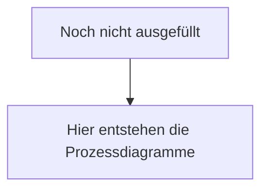

<!-- PURPOSE: Fachliche Abläufe als Diagramm — nicht technische Sequenzen. Ein ##-Abschnitt pro Prozess. Dieses Kapitel hat keine Quelle im Repo: es entsteht aus Gesprächen und gehört nur hierher. -->
---
title: Prozesse & Abläufe
stand:
status: offen
---

# Prozesse & Abläufe

Die wichtigsten Abläufe, Schritt für Schritt. Dargestellt ist, was fachlich passiert — nicht, welcher Code dabei ausgeführt wird.

<!-- ANNA: pro Prozess eine ##-Überschrift mit dem Namen des Ablaufs, z. B. „Eine Anfrage über das Kontaktformular". -->

## Noch nicht ausgefüllt

<!-- ANNA: pro Prozess ein Mermaid-Flowchart plus darunter eine kurze Aufzählung der Schritte in Worten. Das Diagramm allein reicht nicht — manche lesen nur den Text, manche nur das Bild. -->

1. Noch nicht ausgefüllt
