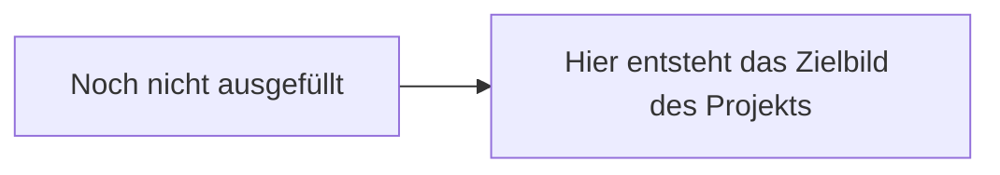

<!-- PURPOSE: Startseite der Stakeholder-Doku. {{STECKBRIEF}} wird vom Generator durch die Steckbrief-Karte ersetzt. -->
---
title: Übersicht
stand:
status: offen
---

# Projektdokumentation

Diese Dokumentation beschreibt das Projekt für alle Beteiligten — auch für die, die nicht täglich mit der Technik arbeiten. Fachbegriffe werden dort erklärt, wo sie zum ersten Mal auftauchen. Jedes Kapitel steht für sich; die Navigation links führt überall hin, die Suche oben rechts findet jeden Begriff.

{{STECKBRIEF}}

## Für wen welches Kapitel gedacht ist

<!-- ANNA: Zeilen zu Kapiteln, die es in diesem Projekt nicht gibt (Slim-Profil), hier entfernen. -->

| Wenn Sie … | sind diese Kapitel wichtig |
|---|---|
| wissen wollen, worum es überhaupt geht | Überblick & Zweck · Funktionen & Features |
| gestalten oder Inhalte beisteuern | Funktionen & Features · Prozesse & Abläufe |
| entscheiden oder budgetieren müssen | Stand & Roadmap · Risiken & offene Punkte |
| den laufenden Betrieb verantworten | Deployment & Betrieb · Schnittstellen & externe Dienste |
| Datenschutz prüfen | Daten & Datenschutz · Schnittstellen & externe Dienste |

## Zielbild in Kurzform

<!-- ANNA: das Zielbild als Mermaid-Flowchart — die wichtigsten Bausteine und wie sie zusammenhängen. Bewusst grob: fünf bis acht Kästen, keine technischen Details. -->

